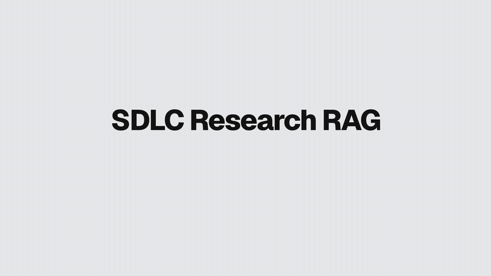

# SDLC Research RAG

[](https://github.com/agzyamov/sdlc-research-rag/actions/workflows/ci.yml) [](LICENSE) 

A RAG app over **arXiv research on AI across the software development lifecycle**: LLMs and agents for requirements, design, coding, testing, code review, operations and maintenance. It answers questions with citations to papers, **extracts** structured facts (SDLC phase, technique, model, benchmark), **visualizes** the research landscape as charts and a knowledge graph, and **evaluates** its own answer quality.

[](docs/media/demo.mp4)

*30-second walkthrough, no sound; click for the full-resolution MP4. The chat answer in it is staged from the corpus's verified abstract quotes.*

> Status: working end to end on a 20-paper corpus (the newest matching arXiv papers). Evaluation results: [eval/README.md](eval/README.md).

## Features

| Feature | Where |
|---|---|
| Q&A over papers with citations (streamed) | LangChain + LangGraph (`sdlcrag.generation`), assistant-ui chat in `web/` |
| Fact extraction + visualization (lifecycle and fact bar lists, knowledge graph, drill-through to papers) | `sdlcrag.extraction` (Neo4j + neo4j-graphrag entity resolution) → `sdlcrag.api` → `web/` (Tremor BarList, Sigma.js) |
| Live corpus: daily arXiv updates without a vector DB rebuild | `sdlcrag.orchestration` (Dagster) + `sdlcrag.ingestion` (OAI-PMH) + `sdlcrag.indexing` (LangChain Indexing API, Qdrant) |
| License-aware access control | `sdlcrag.access` (OpenFGA) + `sdlcrag.retrieval` (pre-filtered search) |
| Multimodal RAG over figures (architecture diagrams, result charts) | `sdlcrag.ingestion.multimodal` (Docling + Claude vision) |
| RAG evaluation, including a long-context baseline | `sdlcrag.evaluation` (DeepEval), [eval/README.md](eval/README.md) |

Dataset and licensing: [data/README.md](data/README.md). The repository never redistributes papers.

## Architecture

The architecture is documented with SEI **Views and Beyond**. Start at [docs/architecture/README.md](docs/architecture/README.md).
The **Module View** ([01-module-view.md](docs/architecture/01-module-view.md)) is the quality gate for where code goes. It is enforced by `import-linter`, and the diagrams are regenerated from the code.

Stack: Dagster · LangChain/LangGraph · Claude (Anthropic API by default; any OpenAI-compatible gateway or local Qwen 3.5 via Ollama per role) · Docling · Qdrant (hybrid dense + BM25) · Neo4j + neo4j-graphrag (knowledge graph, entity resolution) · Qwen3-Embedding · bge-reranker · OpenFGA · DeepEval · Langfuse · FastAPI + assistant-stream · uv/ruff/pyrefly.

Web (`web/`, TypeScript 7): React · Vite · assistant-ui · shadcn/ui + Tremor BarList · Sigma.js + graphology · TanStack Query · nuqs · orval (client generated from [`contracts/openapi.json`](contracts/openapi.json)) · oxlint · dependency-cruiser. Python and TypeScript meet only at that HTTP contract (ADR-0019).

## Quick start

```bash
# prerequisites: uv, Docker (or Colima), Node 24 + pnpm; an Anthropic API key
# optional: an OpenAI-compatible LLM gateway, or Ollama for $0/offline bulk work (ADR-0015)
cp .env.example .env           # set ANTHROPIC_API_KEY (or switch roles to a gateway/local backend)
uv sync
docker compose up -d qdrant neo4j openfga      # core services
docker compose --profile observability up -d   # optional: Langfuse at http://localhost:3000
infra/openfga/bootstrap.sh     # once: create the OpenFGA store (license-aware access)

uv run sdlcrag ingest          # newest 20 papers (data/corpus.yaml window); calls the LLM for fact extraction
uv run sdlcrag update          # incremental arXiv sync

uv run sdlcrag serve           # API on http://127.0.0.1:8000
pnpm -C web install && pnpm -C web dev   # web app on http://127.0.0.1:5173 (proxies /api)

# optional: Dagster UI, daily schedule and automation
DAGSTER_HOME=$PWD/.dagster uv run dagster dev -m sdlcrag.orchestration.definitions -p 3070
```

## Development

```bash
uv run pytest                 # unit + architecture tests
uv run lint-imports           # Module View gate
uv run ruff check . && uv run ruff format --check .
uv run pyrefly check
uv run pytest -m eval         # RAG evaluation (needs Claude access + an index)

pnpm -C web check             # API types fresh, tsc, oxlint, dependency-cruiser
pnpm -C web build
pnpm -C web e2e               # acceptance tests (Playwright, mocked API): docs/acceptance-criteria.md
pnpm -C web e2e:live          # same specs against the real stack (needs services + corpus)
```

After changing `sdlcrag.api`: `uv run python tools/gen_api_contract.py && pnpm -C web gen:api`.

See [CONTRIBUTING.md](CONTRIBUTING.md).

## Community

- [Contributing](CONTRIBUTING.md) · [Code of conduct](CODE_OF_CONDUCT.md) · [Security policy](SECURITY.md)
- Questions and bugs: [issues](https://github.com/agzyamov/sdlc-research-rag/issues).

## License

Code: [Apache-2.0](LICENSE); third-party material is listed in [NOTICE](NOTICE). Papers remain under their own licenses and are not part of this repository.
