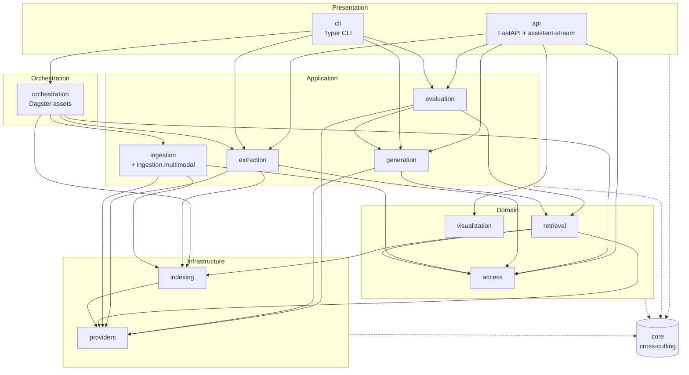
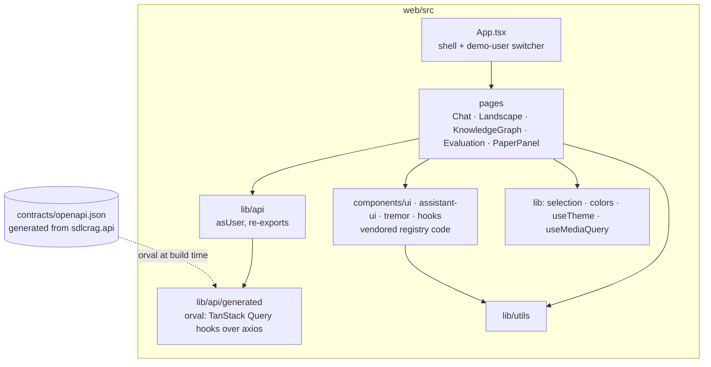

# Module View: decomposition, uses, layered

> **Quality gate.** Code may only be placed in the modules listed here. If a change does not fit any element's responsibility, stop and escalate for an architectural decision.
> Enforced by `import-linter` (`[tool.importlinter]` in `pyproject.toml`) and `tests/unit/test_architecture.py`.

## 1. Primary presentation

### 1.1 Layered style (relaxed: a module may use any module in a *lower* layer, never a higher one)

### 1.2 Exact layer order (import-linter contract, top → bottom)

| Order | Layer members (`\|` = siblings must **not** import each other) |
|---|---|
| 1 | `cli` \| `api` |
| 2 | `orchestration` |
| 3 | `evaluation` |
| 4 | `generation` \| `extraction` \| `ingestion` |
| 5 | `retrieval` \| `visualization` |
| 6 | `access` |
| 7 | `indexing` |
| 8 | `providers` |
| 9 | `core` |

Additional contract: `visualization` may depend only on `core` (pure rendering of domain models).

## 2. Element catalog

| Module | Layer | Responsibility | Key interfaces (planned) | Capability |
|---|---|---|---|---|
| `sdlcrag.api` | Presentation | HTTP API for the web front end (ADR-0019): `/api/chat` streams answers and cited sources in assistant-ui's data-stream protocol (assistant-stream); JSON endpoints for the license-aware landscape, knowledge graph, evaluation report and demo principals; response models are the HTTP contract (`contracts/openapi.json`) | `main.app` (FastAPI), `sdlcrag serve` | chat, visualize, ACL demo |
| `sdlcrag.cli` | Presentation | Typer commands: `ingest`, `update`, `ask`, `extract`, `golden`, `eval`, `tune-retrieval`, `serve` | `main.app` | |
| `sdlcrag.orchestration` | Orchestration | Dagster code location: assets (`corpus_plan`, per-paper `paper_index` and `paper_facts`), schedules, automation; composes the plain-function modules (ADR-0016, ADR-0017) | `definitions.defs` | Corpus update w/o rebuild, extraction |
| `sdlcrag.evaluation` | Application | Golden-set loading, DeepEval metrics (contextual precision/recall, faithfulness, answer relevancy) with Claude as judge, run orchestration, reports, Langfuse score export | `run_evaluation(dataset) -> EvalReport` | RAG evaluation |
| `sdlcrag.generation` | Application | LangGraph RAG graph: retrieve → grade → (rewrite) → generate an answer with citations; prompts | `build_rag_graph()`, `answer(question, principal) -> Answer` | core RAG |
| `sdlcrag.extraction` | Application | LLM structured-output extraction per paper: SDLC phases, techniques, models, benchmarks; license-aware research landscape (fact counts) and graph triples read from the knowledge graph | `extract_paper_facts(...)`, `research_landscape(principal)`, `knowledge_graph(principal)` | extract data |
| `sdlcrag.ingestion` | Application | Corpus pipeline steps as plain functions (orchestrated by `orchestration`): arXiv harvest (initial load + OAI-PMH incremental sync) → Docling parse → chunk → metadata enrichment (paper_id, version, categories, published, license class, section) → hand off to `indexing`; ACL tuple registration via `access` | `ingest(corpus) -> IngestReport`, `update(corpus) -> IngestReport` | |
| `sdlcrag.ingestion.multimodal` | Application (sub-module) | Picture/chart extraction from parsed docs; Claude vision produces text descriptions, which are indexed as chunks with `modality=image` | `describe_figures(doc) -> list[Chunk]` | *Multimodal RAG* |
| `sdlcrag.retrieval` | Domain | Permission-aware hybrid retrieval: ACL pre-filter → Qdrant dense + BM25 with RRF fusion → cross-encoder rerank | `Retriever.retrieve(query, principal, k) -> list[RetrievedChunk]` | *ACL-aware RAG* |
| `sdlcrag.visualization` | Domain | Chart series (SDLC phases in lifecycle order, top-N facts) and knowledge-graph data (NetworkX merge, node-link JSON) for the web front end, built from `core.models`; rendering happens in `web/` | `phase_series(slices)`, `top_series(slices)`, `graph_json(triples)` | visualize |
| `sdlcrag.access` | Domain | Principals, OpenFGA client, license-aware authorization model and tuples; `readable_paper_ids(principal)` for the pre-filter, `can_read()` for the post-filter | `AccessPolicy` protocol | *ACL-aware RAG* |
| `sdlcrag.indexing` | Infrastructure | The stores. **Vector store** (`store`): Qdrant hybrid (langchain-qdrant: dense + BM25, payload indexes) and LangChain Indexing API (`index()` + `SQLRecordManager`: content hashes, per-paper cleanup), giving incremental add/update/delete with no rebuild. **Knowledge graph store** (`graph`): Neo4j papers and facts, neo4j-graphrag entity resolution, Cypher reads filtered by readable papers (ADR-0018) | `get_vector_store()`, `index_paper_chunks()`, `delete_paper()`, `write_paper_facts()`, `resolve_entities()`, `fact_counts()`, `fact_edges()` | *Corpus update w/o rebuild* |
| `sdlcrag.providers` | Infrastructure | Factories for external capabilities: chat/vision models per role (local Ollama, OpenAI/Azure-compatible gateway, or Claude API; ADR-0015), dense + sparse embeddings, reranker, arXiv clients (OAI-PMH, search API, PDF), Langfuse callback handler | `get_llm()`, `get_embeddings()`, `get_sparse_embeddings()`, `get_reranker()`, `arxiv_client()`, `tracing_callbacks()` | |
| `sdlcrag.core` | Cross-cutting | Settings (pydantic-settings), shared domain models, logging | `Settings`, `get_settings()`, `models.*` | |

## 2a. Web front end (`web/`, TypeScript; ADR-0019)

A separate module tree outside the Python package. It depends on the backend only through the HTTP contract `contracts/openapi.json`, never through code. Rules are enforced by dependency-cruiser (`web/.dependency-cruiser.cjs`) and oxlint.

| Element | Responsibility | Rules |
|---|---|---|
| `pages/*` | One page per tab: assistant-ui chat on `/api/chat`, landscape (lifecycle strip and fact lists as clickable bar lists), knowledge graph (Sigma.js), evaluation tables; `PaperPanel`: the drill-through panel shared by Landscape and graph (`/api/papers`) | presentation only: no access, license or scoring logic; all filtering happens server-side |
| `App.tsx` | Layout, tabs, demo-user switcher | |
| `components/ui`, `components/assistant-ui`, `components/tremor`, `hooks` | Vendored registry code (shadcn, assistant-ui, Tremor BarList, and their hooks); local edits are allowed and noted in the file header | may use `lib/utils` and `hooks`; never pages, `App` or `lib/api` |
| `lib/selection`, `lib/colors`, `lib/useTheme`, `lib/useMediaQuery` | Drill-through selection in the URL (nuqs), lifecycle phase colours and token resolution for WebGL (culori), theme and breakpoint hooks | no UI; never pages or components |
| `lib/api` | The single entry point to the backend: generated hooks and types, `asUser` (user in header and query key) | the only importer of `lib/api/generated` and axios |
| `lib/api/generated.ts` | orval output from the contract; never edited by hand | freshness checked in pre-commit and CI |

A new top-level folder under `web/src/` needs an entry here and approval, like a new Python package.

## 3. Context
Outside this view: external services (LLM gateway / Anthropic API, local Ollama, arXiv, Hugging Face Hub, Qdrant, Neo4j, OpenFGA, Langfuse). They are reached **only** through `providers`, `indexing` (Qdrant, Neo4j) and `access` (OpenFGA).

## 4. Variability guide
- LLM backend and model per role, embedding and reranker models: configuration in `core.config`, wired in `providers`. No code change elsewhere.
- Vector store swap: confined to `indexing` (needs an ADR).
- Authorization engine swap: confined to `access` (`AccessPolicy` protocol).
- New document sources (e.g. other arXiv categories, the Public Jira Dataset): new loaders inside `ingestion`.

## 5. Rationale
See [adr/](adr/). The layering keeps volatile external dependencies (models, stores) at the bottom, behind factory and adapter interfaces. That supports the modifiability scenarios in [04-quality-attributes.md](04-quality-attributes.md).
