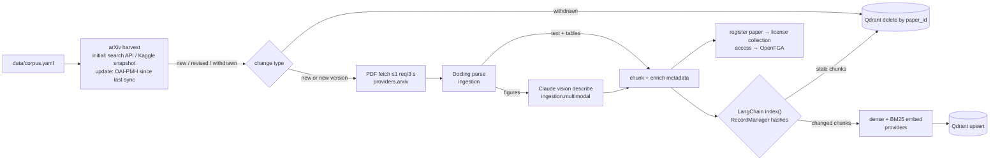
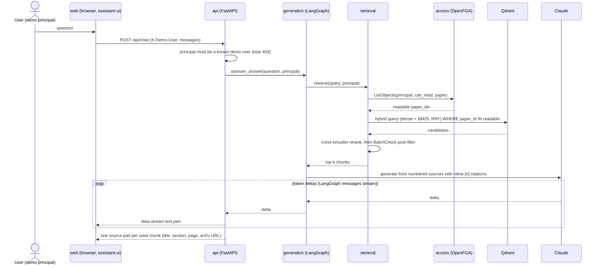

# Component & Connector View

## 1. Primary presentation

### 1.1 Ingestion and incremental update (pipe-and-filter)

Orchestration: Dagster assets `corpus_plan` → `paper_index` (one dynamic partition per paper), run by `sdlcrag ingest|update` in-process or by `dagster dev` (daily schedule plus eager automation). Incremental update harvests OAI-PMH records since the `harvested_until` metadata of the last `corpus_plan` materialization. Unchanged chunk hashes are skipped. A new paper version replaces only its changed chunks, and withdrawn papers are deleted by id. The collection is never rebuilt.

### 1.2 Question answering (browser → API stream → LangGraph)

The `cli` (`sdlcrag ask`) and the evaluation runner call the same graph without streaming (`generation.answer`).

### 1.2a Dashboards (browser → API JSON)
`web` calls `/api/landscape`, `/api/papers`, `/api/graph`, `/api/eval` and `/api/principals` through the orval-generated TanStack Query hooks. Drill-through: clicking a phase, fact or graph node puts the selection in the URL (nuqs) and asks `/api/papers` for the readable papers having those facts (Cypher over the OpenFGA-readable set); `/api/landscape` takes the same filters to cross-filter the lists. Per-user endpoints take `X-Demo-User`, and the user is part of the query key, so cached responses never cross users. The API resolves the readable papers with OpenFGA and runs Cypher on Neo4j (section 1.3). Request and response shapes are the HTTP contract `contracts/openapi.json` (ADR-0019).

### 1.3 Extraction → visualization
The Dagster asset `paper_facts` (one partition per paper, after `paper_index`) has Claude (extraction role, schema-constrained `json_schema` output) read the title and abstract and writes `PaperFacts` (SDLC phases, techniques, models, benchmarks) to the **Neo4j** knowledge graph (`(:Paper)-[:ADDRESSES|USES|EVALUATED_ON]->(fact)`, `MERGE` on name). The unpartitioned asset `entity_resolution` then runs neo4j-graphrag's `FuzzyMatchResolver` to merge spelling variants of technique names (ADR-0018). At view time, `extraction.research_landscape` counts papers per fact with Cypher over the papers the user may read (OpenFGA), and `extraction.knowledge_graph` returns the edges as `Triple`s. `visualization` turns them into chart series and node-link graph data, which `api` serves to `web` (bar lists, Sigma.js graph). Charts and graph are therefore license-aware, like answers.

### 1.4 Evaluation run
`evaluation` loads `eval/golden_qa.jsonl`, runs `generation.answer` for each item (as an evaluation principal), computes the DeepEval metrics with Claude as judge, writes `eval/reports/<timestamp>.json`, and optionally pushes scores to Langfuse.

## 2. Element catalog (runtime components)

| Component | Kind | Connector |
|---|---|---|
| Web app (React SPA, `web/`) | browser | HTTP JSON + HTTP stream (assistant-ui data-stream protocol) to the API |
| API server (`sdlcrag serve`, FastAPI/uvicorn) | host process | serves `/api/*`; in-process calls into generation, extraction, evaluation |
| Typer CLI | process | in-process calls |
| Neo4j (+ APOC) | server (docker) | Bolt (`neo4j` driver, neo4j-graphrag resolvers) |
| Dagster (webserver + daemon, optional) | host process | runs corpus assets on schedule; UI at :3070; instance in `.dagster/` |
| LangGraph RAG graph | in-process state machine | function calls; Langfuse callback (HTTP) |
| Qdrant | server (docker) | HTTP/gRPC (`qdrant-client`) |
| OpenFGA (+ Postgres) | server (docker) | HTTP (`openfga-sdk`) |
| LLM gateway (Claude) or Anthropic API | external SaaS | HTTPS (OpenAI/Azure-compatible or Anthropic Messages API) |
| Ollama (optional local LLM, `qwen3.5:9b`) | host process | HTTP, OpenAI-compatible (`localhost:11434/v1`) |
| arXiv (OAI-PMH, API, PDFs) | external | HTTPS, ≤1 request / 3 s |
| HF models (Qwen3-Embedding, BM25, bge-reranker) | in-process (MPS/CPU) | — |
| Langfuse (optional) | server stack (docker) | HTTPS/OTel |

## 3. Rationale
See ADRs 0004 (Qdrant), 0007 (OpenFGA), 0008 (DeepEval), 0009 (Langfuse).
