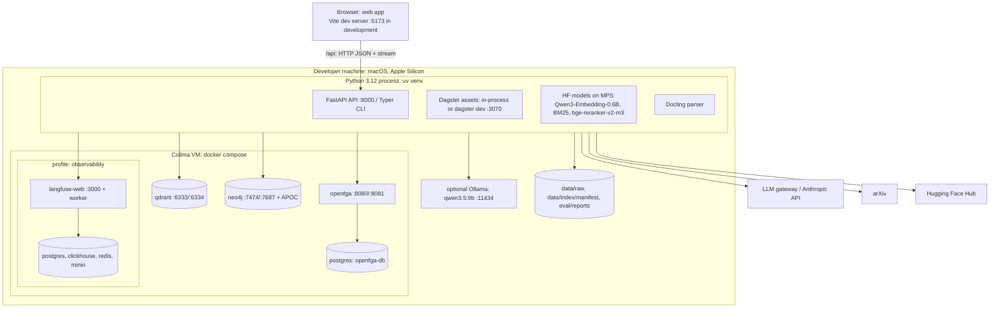

# Allocation View: deployment + implementation

## 1. Deployment

| Artifact | Runs on | Defined in |
|---|---|---|
| API / CLI | host Python (uv) | `pyproject.toml` (`sdlcrag` script; `sdlcrag serve`) |
| Web app | browser; built by Vite into static files, served in development by the Vite server (:5173, proxies `/api` to :8000) | `web/package.json`, `web/vite.config.ts` |
| Local LLM (optional) | host Ollama (Metal/MLX) | `ollama pull qwen3.5:9b`; set a role's backend to `local` in `.env` |
| Qdrant, Neo4j, OpenFGA, Langfuse | Colima containers | `compose.yaml` |
| OpenFGA authorization model | OpenFGA store | `infra/openfga/model.fga` |
| Corpus state | host filesystem | `data/index/` (RecordManager SQLite), `.dagster/` (Dagster instance) |

## 2. Implementation mapping (module → path)

| Module (01-module-view) | Path |
|---|---|
| `sdlcrag.api` | `src/sdlcrag/api/` |
| `sdlcrag.cli` | `src/sdlcrag/cli/` |
| `sdlcrag.orchestration` | `src/sdlcrag/orchestration/` |
| `sdlcrag.evaluation` | `src/sdlcrag/evaluation/` |
| `sdlcrag.generation` | `src/sdlcrag/generation/` |
| `sdlcrag.extraction` | `src/sdlcrag/extraction/` |
| `sdlcrag.ingestion` | `src/sdlcrag/ingestion/` |
| `sdlcrag.ingestion.multimodal` | `src/sdlcrag/ingestion/multimodal/` |
| `sdlcrag.retrieval` | `src/sdlcrag/retrieval/` |
| `sdlcrag.visualization` | `src/sdlcrag/visualization/` |
| `sdlcrag.access` | `src/sdlcrag/access/` |
| `sdlcrag.indexing` | `src/sdlcrag/indexing/` |
| `sdlcrag.providers` | `src/sdlcrag/providers/` |
| `sdlcrag.core` | `src/sdlcrag/core/` |

Outside the application package:

| Path | Purpose |
|---|---|
| `docs/architecture/` | this documentation (`generated/` is produced by `tools/gen_diagrams.py`) |
| `docs/media/` | README demo: `demo.mp4`, `demo.gif`, and the HyperFrames project in `demo/` that renders them from real app frames (captured by `web/capture/`, never run in CI) |
| `data/` | dataset definition and local corpus |
| `eval/` | golden set and reports |
| `infra/` | service configuration (OpenFGA model) |
| `tools/` | developer tooling (diagram generation, HTTP contract export, Mermaid validation); not shipped, not part of the Module View |
| `web/` | web front end (TypeScript; its own module tree, see 01-module-view §2a) |
| `web/e2e/` | Playwright acceptance tests (mocked API fixtures, specs per acceptance criterion; ADR-0020); not shipped |
| `contracts/` | `openapi.json`: the HTTP contract, generated from `sdlcrag.api`, consumed by orval in `web/` |
| `tests/` | unit, integration and eval tests |
| `.github/workflows/` | CI quality gates |
