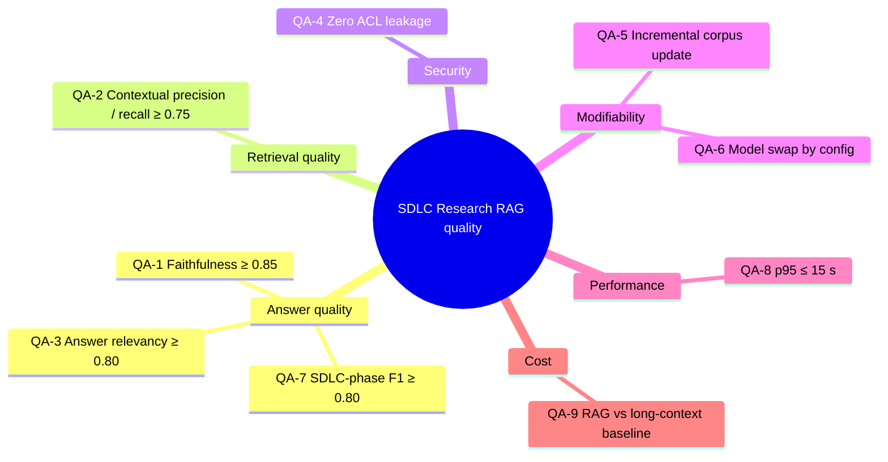

# Quality attributes (beyond views)

## Utility tree

## Scenarios

Scenarios use the SEI six-part form: source · stimulus · artifact · environment · response · **response measure**.

| ID | QA | Scenario | Response measure | Verified by |
|---|---|---|---|---|
| QA-1 | **Groundedness** (safety) | A user asks a question about AI-for-SE research; the system generates an answer | Faithfulness ≥ 0.85 (DeepEval, Claude judge) on the golden set; every claim cites a chunk | `pytest -m eval` |
| QA-2 | **Retrieval quality** | Golden question with known supporting passages | Contextual precision ≥ 0.75, contextual recall ≥ 0.75 | `pytest -m eval` |
| QA-3 | **Answer relevancy** | Golden question | Answer relevancy ≥ 0.80 | `pytest -m eval` |
| QA-4 | **Security / confidentiality** | A public principal asks about a paper under the arXiv non-exclusive license | 0 restricted chunks in the retrieved context (pre-filter), so the answer reveals nothing | ACL tests in `tests/` (integration) |
| QA-5 | **Modifiability: corpus** | The daily OAI-PMH sync brings new papers, new versions and withdrawals; the oldest papers fall out of the 2k window | Only the affected chunks are embedded/deleted; no collection rebuild; unchanged docs re-embedded = 0 | `Manifest.diff` tests + ingest report |
| QA-6 | **Modifiability: models** | Swap the embedding or LLM model | Configuration change only (`.env`); no code outside `providers` changes | Module View + import-linter |
| QA-7 | **Extraction accuracy** | SDLC phases extracted for a paper | Macro-F1 ≥ 0.80 vs. a hand-labeled sample; metadata exact match = 1.0 vs. arXiv | `pytest -m eval` (extraction) |
| QA-9 | **Cost-effectiveness** | Same golden questions answered by RAG vs. a long-context baseline (full texts stuffed) | RAG ≥ baseline on faithfulness at ≤ 20% of its cost per question | `sdlcrag eval --baseline` |
| QA-8 | **Performance** (local) | Single question on the 2k-paper corpus | p95 end-to-end latency ≤ 15 s on an M-series Mac | manual / Langfuse traces |

The thresholds are initial targets and get calibrated after the first baseline evaluation run.
