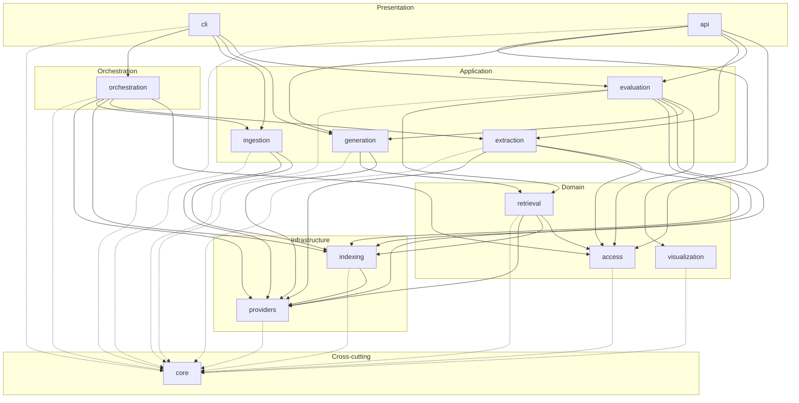

<!-- GENERATED by tools/gen_diagrams.py. Do not edit by hand. -->
<!-- Regenerate: uv run python tools/gen_diagrams.py -->

# Module dependencies: as implemented

Actual `import` relations between Module View elements, extracted from the source with [grimp](https://github.com/python-grimp/grimp). Compare this with the *intended* uses in [01-module-view.md](../01-module-view.md). Upward edges are blocked by import-linter.

- Edges: 42 (dotted = uses `core`)
- Packages not in the Module View: none
